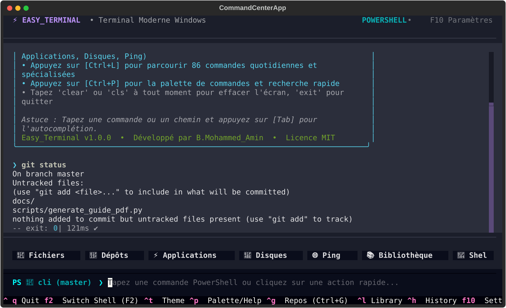
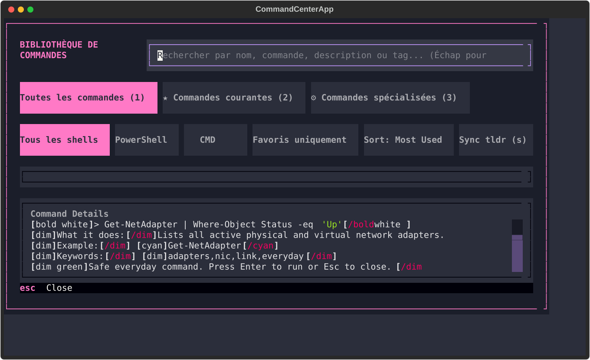
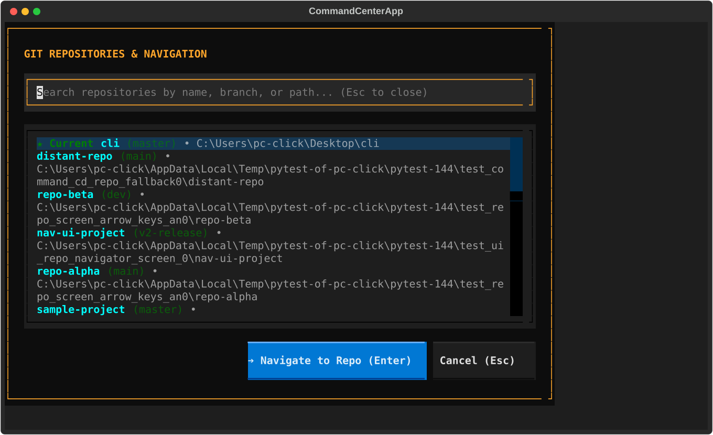
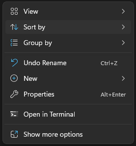

# ⚡ Easy_Terminal

[](LICENSE)
[](https://microsoft.com)
[](https://www.python.org)
[](#-bilingual-support-en--fr)
[](https://github.com/b-mohammed-amin/Easy_Terminal/releases)
[](https://github.com/b-mohammed-amin)

> **The Modern, Safe, and Visual Windows Command Center**  
> *Transform terminal workflows into an intuitive, productive, and beginner-friendly experience.*

---

## 🌟 Overview

**Easy_Terminal** turns standard Windows command-line environments (**PowerShell** and **Command Prompt**) into an interactive, visual console. It eliminates the frustration of memorizing obscure flags, provides instant project switching, protects against accidental file deletion, and includes an offline library of **529 categorized commands**.

Whether you are a developer, system administrator, student, or power user, Easy_Terminal gives you the speed of the command line with the clarity and comfort of a modern graphical interface.

---

## 📸 Screenshots

| Main Terminal & Status Bar | 529+ Command Library (`Ctrl+L`) |
| :---: | :---: |
|  |  |

| Git Repositories Navigator (`Ctrl+G`) | Windows Explorer Right-Click Menu |
| :---: | :---: |
|  |  |

---

## ✨ Key Features

- **🚀 Persistent Dual Shell Engine (`F2`)**  
  Switch instantly between **PowerShell** and **Command Prompt** (`cmd.exe`) without losing current working directories or environment variables.
- **📚 529+ Categorized Built-in Commands (`Ctrl+L`)**  
  Exhaustive command encyclopedia divided into **Everyday Common** and **Specialized** developer tools across 12 categories (*Files, Network, Disk, System, Processes, Services, Users, Search, Security, Git, PowerShell, Batch*).
- **🌿 Git Auto-Discovery & Instant Jumps (`Ctrl+G`)**  
  Tracks your local Git repositories automatically, displays live branch indicators, and lets you jump between projects in milliseconds with `Ctrl+G` or CLI `goto <repo>`.
- **🔍 Fuzzy Command Palette (`Ctrl+P`)**  
  Global keyboard-driven fuzzy search to locate any command, tool, or setting instantly.
- **🛡️ Destructive Command Guard**  
  Scans submitted commands and prompts for explicit confirmation before running dangerous operations (`del /s`, `rmdir /s`, `format`, `Remove-Item -Recurse`, `diskpart`, `shutdown`, `reg delete`).
- **🖱️ 1-Click Action Bar**  
  Seven quick-access buttons right above the prompt: `📁 Files`, `⚡ Top Apps`, `💾 Disks`, `🌐 Ping`, `📚 Library`, `🐚 Shell`, and `🧹 Clear`.
- **🌐 Bilingual Support (EN / FR)**  
  Full multi-language support in English and French. Switch languages instantly via the Settings menu (`F10`).
- **⚡ Windows Explorer Context Menu**  
  Right-click any folder or hard drive partition in Windows Explorer and choose **"Open in Terminal"** to launch directly at that location.
- **💼 Zero-Install Portable Mode**  
  Run directly from a USB flash drive or folder without administrator privileges. Creates a local `data/` folder and leaves zero traces in `%APPDATA%`.

---

## 📥 Downloads & Installation

Easy_Terminal is distributed in two ready-to-run editions:

### 1. Windows Setup Wizard (Recommended)
Download **`Easy_Terminal-Setup.exe`** from the [Releases](https://github.com/b-mohammed-amin/Easy_Terminal/releases) section:
- Guided native Inno Setup installation wizard.
- Automatically creates Desktop and Start Menu shortcuts.
- Registers *“Open in Terminal”* in the Windows Explorer right-click context menu.
- Clean uninstallation via Windows Settings / Control Panel.

### 2. Portable Edition (Zero-Install)
Download and unzip **`Easy_Terminal-Portable.zip`**:
- 100% self-contained for USB flash drives and portable toolkits.
- Keeps all database history, settings, and favorites inside `./data/`.
- Leaves no files in `%APPDATA%` on host machines.

---

## 📖 User Guides & Documentation

Full 7-page, high-resolution printable PDF user guides with screenshots:
- 🇬🇧 **[English User Guide (PDF)](docs/Easy_Terminal_User_Guide.pdf)**
- 🇫🇷 **[Guide d'Utilisation en Français (PDF)](docs/Easy_Terminal_Guide_Utilisateur.pdf)**

---

## ⌨️ Keyboard Shortcuts Reference

| Shortcut | Action | Description |
| :--- | :--- | :--- |
| **`Ctrl + L`** | **Command Library** | Browse and search 529+ everyday and specialized commands |
| **`Ctrl + P`** | **Command Palette** | Global fuzzy search across all tools, commands, and settings |
| **`Ctrl + G`** | **Git Repositories** | Quick-jump navigator between tracked Git projects |
| **`F2`** | **Switch Shell** | Toggle between PowerShell, Command Prompt, and WSL |
| **`Ctrl + H`** | **History** | Filter, search, and rerun previously executed commands |
| **`Ctrl + T`** | **Toggle Theme** | Cycle console themes (Modern Dark, Matrix Green, Midnight) |
| **`Ctrl + Y`** | **Copy Output** | Copy output of the last command to Windows clipboard |
| **`Ctrl + R`** | **Restart Shell** | Restarts background shell process without closing UI |
| **`F10`** | **Settings** | Configure language (English/French), default shell, and safety |
| **`Tab`** | **Auto-Complete** | Auto-completes file paths, directories, and command names |
| **`↑ / ↓`** | **History Navigation** | Cycle through recently executed commands |
| **`Ctrl + C`** | **Interrupt / Clear** | Interrupt running execution or clear current prompt line |
| **`Ctrl + Q`** | **Quit** | Exits Easy_Terminal cleanly |

---

## 🛠️ Running from Source

### Prerequisites
- **Windows 10 / 11** (64-bit)
- **Python 3.10+**

### Step-by-Step Setup
```powershell
# 1. Clone the repository
git clone https://github.com/b-mohammed-amin/Easy_Terminal.git
cd Easy_Terminal

# 2. Create and activate a virtual environment
python -m venv .venv
.\.venv\Scripts\activate

# 3. Install dependencies
pip install -r requirements.txt

# 4. Launch Easy_Terminal
python -m command_center

# 5. Run automated test suite
python -m pytest tests/
```

---

## 📦 Building Distributions & Documentation

To recompile the standalone native executable, installer, and user manuals:

```powershell
# Compile PDF manuals with live screenshots
python scripts/generate_guide_pdf.py

# Package PyInstaller binary, portable ZIP, and Inno Setup installer
python scripts/package_release.py
```

Distribution artifacts will be generated inside the `dist/` folder:
- `dist/Easy_Terminal-Setup.exe` (Standalone Windows Installer)
- `dist/Easy_Terminal-Portable.zip` (Portable Edition)

---

## 📄 License & Credits

- **Author**: **B.Mohammed_Amin**
- **License**: Released under the open-source **[MIT License](LICENSE)**.

```
Copyright (c) 2026 B.Mohammed_Amin

Permission is hereby granted, free of charge, to any person obtaining a copy
of this software and associated documentation files (the "Software"), to deal
in the Software without restriction, including without limitation the rights
to use, copy, modify, merge, publish, distribute, sublicense, and/or sell
copies of the Software...
```
